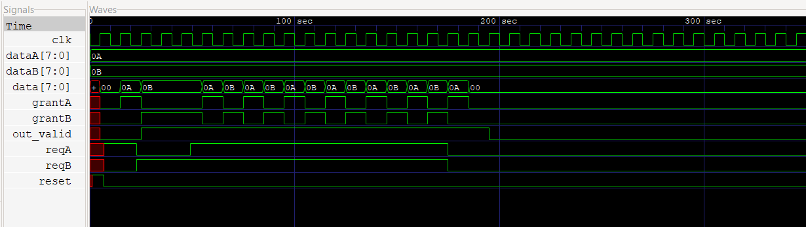
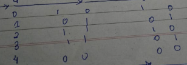

part 2 of the problem
all test cases mentioned
in this when both reqs are high grant alternates 
an from grant 0 to grant 1 transition req a is given priority else the priority is to the other grant which is at zero 

note: i built it like a fsm where states change only at posetive edges
therefore any abrupt transtion to show effeect has to wait till the cycle gets over

cycle table
